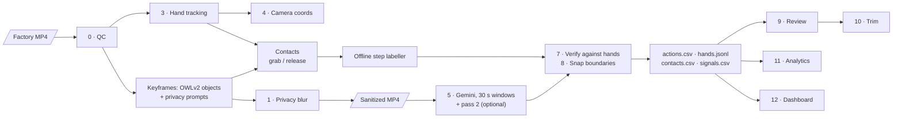

# FORGE · Task-step timeline from head-camera factory video

**Egocentric Vision Hackathon · Problem Statement 3 (PS3): task-step timeline.**
A factory clip goes in; out comes a list of actions with `start_s, end_s, verb, object, hand`, shown next to
a privacy-sanitized copy of the video, plus PS1-format hand tracks and a PS2-format grab/release timeline.

> **Hardware path:** laptop. Windows 11, Intel i5-12450H, NVIDIA RTX 3050 Laptop GPU (4 GB), 16 GB RAM.
> Hand tracking runs on the CPU; the open-vocabulary detector and image embeddings run on the GPU
> (automatic CPU fallback). Gemini (optional) is a cloud API and only ever receives the sanitized copy.
> **Frame-skip strategy:** the hand model runs on every 2nd frame at 960 px; skipped frames are interpolated.

**One command to run the pipeline on a clip:**

```bash
egovision run --video data/raw/MTL-SKL00089-005.mp4 --out outputs
```

No videos, frames or screenshots from the data are in this repository (data-use rules).

---

## What it does



The full 15-stage pipeline (FORGE) is in [docs/PIPELINE.md](docs/PIPELINE.md). Summary:

| Stage | What | Tools |
|---|---|---|
| 0 Ingest + QC | Decode every 2nd frame at 960 px, frame cache, blur/brightness/lens-covered per frame | PyAV, OpenCV |
| 1 Privacy | Pixelate faces (head of every person) and company names (signs, logos); wearer's hands kept sharp | OWLv2 prompts, OpenCV |
| 2 Worker profile | Team-declared expected hands per source (`config/worker_profiles.yaml`) | YAML + Pydantic |
| 3 Hand tracking | 21 keypoints, left/right, stable IDs with re-entry, side vote, One-Euro smoothing, CLAHE retry, coworker-hand filter | MediaPipe Hand Landmarker, SciPy |
| 4 Camera coordinates | Wrist in camera-origin coords, 3×3 zones, speed at 10 Hz → `signals.csv` | NumPy |
| Contacts | ≥2 fingertips inside a padded object box → holds / touches | OWLv2 |
| 5 Step labels | Offline: SigLIP image–text match + held-object cue + hand idle model + Viterbi. Optional Gemini on 30 s windows + pass 2 | SigLIP, Gemini API |
| 6 Validation | Schema, fixed 17-verb list, times clamped | Pydantic |
| 7 Verification | Each action checked against hand presence, motion and contacts → verified / corrected / unverified / rejected | own code |
| 8 Order + boundaries | Boundaries snapped to hand-motion valleys; per-source step template; missing / out-of-order / repeated flags | own code (DP / LCS) |
| 9 Review | Queue sorted by uncertainty; approve / edit / split / merge / reject; separate `review.json` layer | FastAPI + JS |
| 10 Trim | Keep-lite trim + H.265 of the sanitized copy after approval; original timestamps kept | PyAV, libx265 |
| 11 Analytics | Time per verb, idle time, two-handed share, work zones, placements, cycles | own code |
| 12 Dashboard | Sanitized video with live hand/object overlay, clickable two-lane timeline, review, downloads | FastAPI, plain JS |
| 13 Evaluation | Segment F1@10/25/50, edit score, frame accuracy, boundary error; hand-judging sheets | own code |
| 14 Data lifecycle | Data never in git; uploads deleted; deletion checklist | [docs/DATA_DELETION.md](docs/DATA_DELETION.md) |

## Outputs (per clip, in `outputs/<clip>/`)

| File | Format |
|---|---|
| `actions.csv` | **PS3 deliverable**: `clip,start_s,end_s,verb,object,hand` (hand = left / right / both / unknown) |
| `hands.jsonl` | PS1 format, one line per frame: `side, bbox, score, kp2d (21 pts)` + `id, source, xy_cam` |
| `contacts.csv` | PS2 format: `clip,t_start,t_end,hand,state,object_name` |
| `signals.csv` | Stage 4: per-hand camera coords, zone, speed, visibility at 10 Hz |
| `actions.json` / `result.json` | Rich record: verification status, flags, evidence, original times, keyframe objects |
| `actions_reviewed.csv` | After human review (Stage 9) |
| `qc.json`, `analytics.json`, `steps_check.json`, `privacy_log.json`, `run.json` | Stage outputs, timings, config used |

## Setup (Windows, Git Bash; same on Linux/macOS with `bin/` instead of `Scripts/`)

```bash
python -m venv .venv
.venv/Scripts/python -m pip install -r requirements.txt
.venv/Scripts/python -m pip install -e . --no-deps
.venv/Scripts/python scripts/download_weights.py      # MediaPipe hand model (sha256-checked)
```

OWLv2 and SigLIP weights download from Hugging Face on first run. Put clips in `data/raw/` (git-ignored).
For the optional Gemini backend, copy `.env.example` to `.env` and set `GEMINI_API_KEY`.

## How to run

```bash
egovision run --video data/raw/<clip>.mp4                    # one clip (add --max-seconds 30 for a quick run)
egovision run --video data/raw/<clip>.mp4 --set steps.backend=gemini   # + Gemini (sanitized copy only)
egovision batch data/raw --skip-done                         # every clip; one failure does not stop the batch
egovision sop                                                # step templates + missing/out-of-order flags
egovision eval                                               # score against labels/ (our own labels)
egovision trim --clip <clip>                                 # after the trim plan is approved in review
egovision ui                                                 # dashboard at http://127.0.0.1:8000
python scripts/make_demo.py --clip <clip>:20:30 --out artifacts/demo.mp4   # presentation video
```

Every threshold lives in one typed config (`src/egovision/config.py`); override with `--set section.key=value`
or `--config my.yaml`. Tests: `pytest` (includes a 10-second smoke test on a real clip).

## Results

See [docs/RESULTS.md](docs/RESULTS.md) for every number, how it was measured and its caveats.
**Labels are our own drafts, not yet checked by a person** ([labels/README.md](labels/README.md)).

## Known limitations

- **No official labels.** Scores come from our own draft labels on 2 held-out clips.
- **Gemini availability.** Whole 3-minute clips returned 503 "high demand" on every model; 30-second
  windows work. If Gemini still fails, the run keeps the offline timeline.
- **Privacy is a safety layer, not anonymisation.** Faces of people far away, partial sign text at frame
  edges, and the wearer's own knees when squatting can be missed or over-blurred. The footage stays
  confidential under the data rules either way.
- **Hands far from the camera** (stone-plant clips) are often missed by MediaPipe; the walking worker's
  hands are visible in only a minority of frames.
- **Camera-relative coordinates.** The camera is on the worker's head, so positions move with the head.
- **Clips are 3-minute slices** of longer recordings, so step templates see partial cycles.

All mistakes we hit, and how they were fixed: [docs/ERRORS_AND_FIXES.md](docs/ERRORS_AND_FIXES.md).
Decisions with the measurements behind them: [docs/DECISIONS.md](docs/DECISIONS.md).

## Models, libraries and APIs used

| Component | Licence |
|---|---|
| MediaPipe Hand Landmarker (`hand_landmarker.task`, float16) | Apache-2.0 |
| OWLv2 `google/owlv2-base-patch16-ensemble` | Apache-2.0 |
| SigLIP `google/siglip-base-patch16-224` | Apache-2.0 |
| Grounding DINO `IDEA-Research/grounding-dino-tiny` (benchmarked, optional) | Apache-2.0 |
| Gemini API (`gemini-3.5-flash`, fallbacks `gemini-flash-lite-latest`, `gemini-3.8-flash`) | Google API terms |
| PyTorch, torchvision | BSD-3-Clause |
| Hugging Face transformers, accelerate | Apache-2.0 |
| OpenCV | Apache-2.0 |
| PyAV (bundles FFmpeg with libx264/libx265) | BSD-3-Clause (PyAV); LGPL/GPL (FFmpeg components) |
| NumPy, SciPy | BSD-3-Clause |
| Pydantic, FastAPI, Typer | MIT |
| uvicorn | BSD-3-Clause |
| google-genai SDK, sentencepiece, protobuf | Apache-2.0 / BSD |

AI coding assistant: Claude Code was used to write code and docs; every team member can explain each stage.

## Team

Khushi, Pranav Garg (and teammates).
