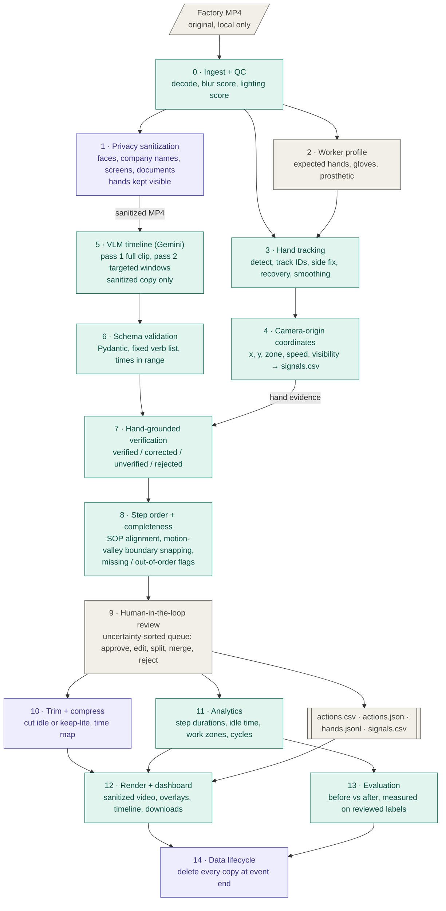

# Pipeline

The full FORGE PS3 pipeline, stages 0–14. The diagram renders on GitHub; paste it into
https://mermaid.live to export a PNG/SVG for the slides.

Colours: teal = automated stages, purple = privacy and data handling, gray = inputs and people.

## Stage summary

| # | Stage | Input → output |
|---|---|---|
| 0 | Ingest + QC | MP4 → frames, `qc.json` |
| 1 | Privacy sanitization | frames + detections → `data/sanitized/<clip>.mp4`, `privacy_log.json` |
| 2 | Worker profile | team-declared YAML → expected manipulators |
| 3 | Hand tracking | original frames → `hands.jsonl` |
| 4 | Camera-origin coordinates | hand tracks → `signals.csv` |
| 5 | VLM timeline | sanitized MP4 → `raw_pass1.json`, `raw_pass2.json` |
| 6 | Schema validation | raw responses → `actions_valid.json` |
| 7 | Hand-grounded verification | actions + signals → status per action |
| 8 | Step order + completeness | verified actions → `actions_refined.json` |
| 9 | Human review | refined actions → `review.json` |
| 10 | Trim + compress | reviewed video → `data/trimmed/<clip>_<mode>.mp4` (`cut`: shorter; `keep_lite`: same length), `trim_map.json` (plan, time map), `actions_trimmed.csv` (cut mode) |
| 11 | Analytics | actions + signals → durations, zones, cycles |
| 12 | Render + dashboard | everything → JS dashboard, annotated MP4 |
| 13 | Evaluation | outputs + reviewed labels → before/after metrics |
| 14 | Data lifecycle | all copies → deleted at event end |

Build status per stage is tracked in `docs/PLAN.md`, not here.

## Privacy guarantees in code
- The dashboard only streams the sanitized copy (`/media/<clip>/sanitized.mp4`); originals are never served.
- The Gemini backend refuses to upload an unsanitized clip unless `steps.allow_unsanitized_upload=true` is set deliberately.
- Overlay and demo renders draw on the sanitized copy.
- Videos are written atomically, so an interrupted run never leaves a half-written file.
